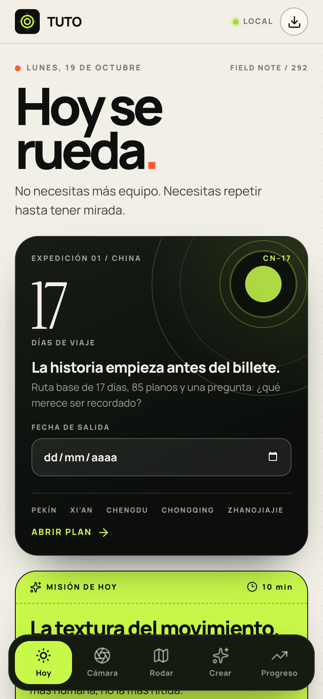
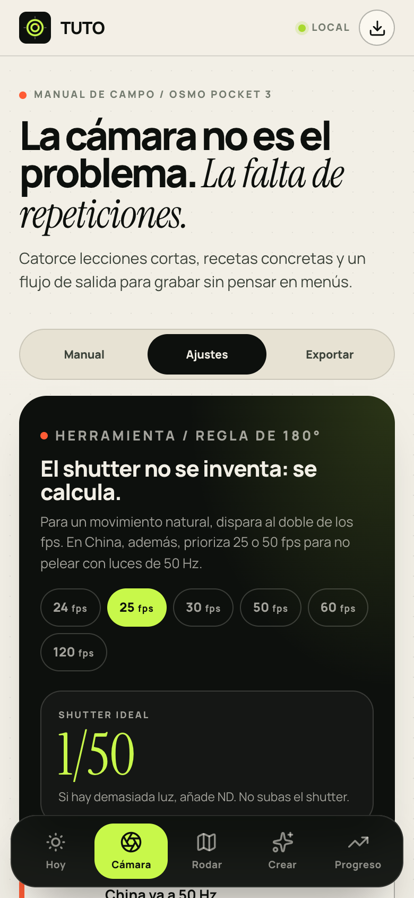
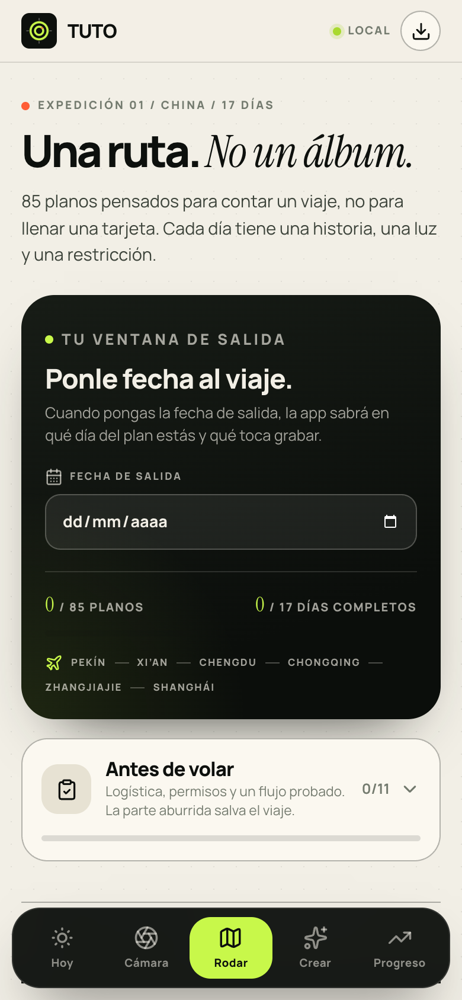
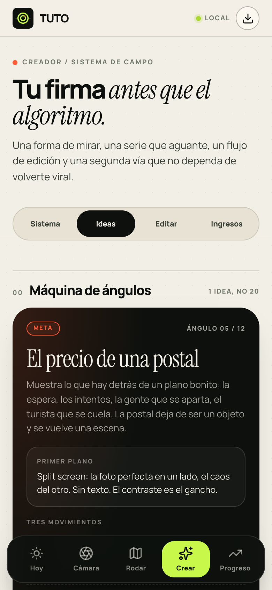

# TUTO — Pocket 3 Field OS

PWA de campo, en español, para dominar la **DJI Osmo Pocket 3**, rodar un viaje de **17 días por China** y construir una **voz propia como creador** — sin fórmulas genéricas ni rutinas de las 5 AM.

Instalable en el móvil y **funciona offline** (útil de verdad en el viaje).

**Demo:** [vgb95.github.io/djituto](https://vgb95.github.io/djituto/)

| Hoy | Cámara | Rodaje | Ideas |
|:--:|:--:|:--:|:--:|
|  |  |  |  |

## Qué contiene

- **Manual de cámara** — 14 lecciones cortas de la Pocket 3, recetas por escena (día, noche, retrato, viaje, comida…), herramienta de **regla de 180°**, glosario pro, y una sección de **exportación**: rutas 10-bit D-Log M, checklists y specs en un sitio.
- **Plan de rodaje China** — **17 días × 5 planos = 85 tarjetas**. Cada plano trae *por qué*, *cómo* y *ajustes*; cada día, ventana de luz, restricción creativa, sonido e idea de montaje. Incluye checklist previo al viaje y frases de consentimiento en chino para grabar a personas.
- **Sistema de creador** — principios propios, máquina de ángulos, gestión de energía, flujo de edición móvil, sistema de clips y una escalera de segunda vía con calculadora de clientes.
- **Progreso** — lecciones dominadas, planos marcados, misiones diarias, racha, notas por día, logros y **backup exportable/importable** en JSON.

## PWA / offline

- Service worker con precache de toda la app (manual, plan, datos) vía Workbox.
- Instálala: Ábrela en Safari/Chrome → **Compartir → Añadir a pantalla de inicio**.
- Tus datos viven en `localStorage` (clave `tuto-pocket-os-v1`). Sin cuentas, sin servidor, sin analítica. Exporta un backup desde *Progreso* antes de cambiar de móvil.

## Stack

Vite 6 · React 19 · TypeScript · React Router 7 (HashRouter) · vite-plugin-pwa (Workbox) · lucide-react · Fontsource (Manrope + Instrument Serif). Cero backend.

## Desarrollo

```bash
npm install
npm run dev        # http://localhost:5173
npm run build      # build de producción en dist/
npm run preview    # sirve el build
npm run lint       # oxlint
```

## Deploy

GitHub Pages automático en cada push a `main` (`.github/workflows/deploy.yml`). El workflow calcula la base del sitio a partir del nombre del repositorio (`DEPLOY_BASE`), así que funciona aunque renombres el repo.

## Nota sobre la ruta

La ruta incluida — **Pekín → Xi'an → Chengdu → Chongqing → Zhangjiajie → Shanghái** — es una base editable de 17 días. La estructura (días, planos, luces y capítulos) está pensada para adaptarse a cualquier itinerario real: ciudades, fechas y planos se pueden reescribir sin tocar la app.
